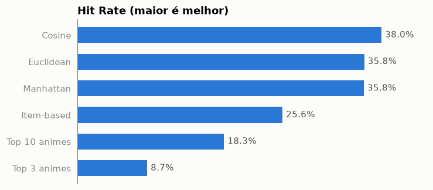

# A Collaborative Filtering Model Applied to Anime Recommendation

*Modelo de filtragem colaborativa aplicada à recomendação de animes*

🇧🇷 [Leia em português](README.pt-br.md)

A rebuild of my final project for the Data Science & Big Data specialization (UFPR, 2024).
The original paper (in Portuguese) is in [`referencias/monografia.pdf`](referencias/monografia.pdf).


## The problem

Recommending anime to a **new** user with no rating history (*cold start*).

## The solution

1. **Clustering (K-means):** anime are grouped into 20 clusters based on their features. The most popular anime in each cluster becomes a "persona".
2. **User-based collaborative filtering:** the user picks up to 3 personas, the model finds the most similar users (`NearestNeighbors`, brute force) and recommends what they liked most. Three distances are compared: Cosine, Manhattan and Euclidean.

## Results

| Model | Hit Rate ↑ | Serendipity ↓ | Distinct anime recommended ↑ |
|---|---|---|---|
| **Cosine** | **38.0%** | **42.2%** | 104 |
| Manhattan | 35.8% | 48.3% | 37 |
| Euclidean | 35.8% | 54.7% | 29 |
| Item-based (baseline) | 25.6% | 49.4% | 110 |
| Top 10 anime (baseline) | 18.3% | — | — |
| Top 3 anime (baseline) | 8.7% | — | — |

- **Hit Rate:** one anime rated 10 is hidden from each test user; it counts as a *hit* if it shows up in the 10 recommendations.
- **Serendipity:** share of recommendations that fall in the Top 10 most popular anime, across every combination of up to 3 personas. Lower means more novelty.

Collaborative filtering hits about twice as often as recommending the most popular anime.
In this rebuild, Cosine distance was the best on both metrics. The original paper chose Manhattan for its lower Serendipity; that difference is discussed in [`04_avaliacao.ipynb`](notebooks/04_avaliacao.ipynb).



## Project structure

Folder names, notebooks and code are in Portuguese.

```
├── dados                <- raw data (not versioned) and processed data
├── modelos              <- K-means and the user × anime matrix
├── notebooks
│   ├── 01_eda.ipynb                      <- exploration and data preparation
│   ├── 02_clusterizacao.ipynb            <- Model 1: K-means and personas
│   ├── 03_filtragem_colaborativa.ipynb   <- Model 2: recommendation
│   ├── 04_avaliacao.ipynb                <- Hit Rate and Serendipity
│   └── src              <- config, helpers, charts and models
├── referencias          <- paper, dataset notes and data dictionary
├── relatorios/imagens   <- charts generated by the notebooks
├── home.py              <- Streamlit app
└── requirements.txt
```

## How to run

```bash
python -m venv .venv
source .venv/bin/activate
pip install -r requirements.txt

streamlit run home.py
```

The app works right after cloning, because the processed data and models are versioned.

To rebuild everything from scratch, download the [Kaggle dataset](https://www.kaggle.com/datasets/hernan4444/anime-recommendation-database-2020), put `anime.csv`, `anime_with_synopsis.csv` and `rating_complete.csv` in `dados/` and run the notebooks in order.
